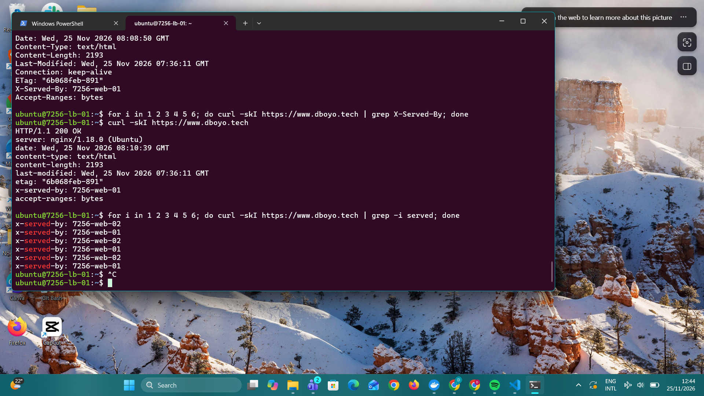

# ☀️ Daylight Around the World

A web app that compares how much daylight 19 cities around the world get on any date — and how many hours of **usable light** people have for outdoor work like farming, building and travel.

🔗 **Live app:** https://www.dboyo.tech
🎥 **Demo video:** https://youtu.be/yNAgivuQM3k

---

## Why this app?

Day length is not the same everywhere. On 24 November, Kigali gets about **12h 13min** of daylight, Oslo about **7h**, and Tromsø (Norway) less than **2h**. This app shows how **latitude** and **seasons** change daylight, and helps people plan outdoor work around the light they actually have.

> I decided to choose this application because if your job needs daylight to work you should be aware of the amount the daylight need to maximize your efficient like a farmer, builder, or someone who travels for work. Also if you are to work with solar systems you not the exact amount and time you need to get maximum sun-light energy

---

## Features

| Feature | What it does |
|---|---|
| 📅 **Date picker** | See daylight for any date (e.g. 21 June vs 21 December) |
| 🔍 **Search** | Find a city or country by name |
| 🌍 **Filter** | Show only Northern or Southern hemisphere cities |
| ↕️ **Sort** | Longest day, shortest day, most usable light, earliest sunrise, or A–Z |
| 📊 **Summary** | Longest day, shortest day and the difference between them |
| 🔆 **Usable light** | Time from first light to last light (more than sunrise → sunset) |
| 🌑 **Polar cases** | Shows "midnight sun" and "polar night" for cities near the poles |
| ⚡ **Caching** | A date loaded once is shown instantly the next time (no extra API calls) |
| ⚠️ **Error handling** | Clear messages + a Retry button (see below) |

---

## Project structure

```
├── index.html          # Page structure
├── style.css           # Design (responsive)
├── script.js           # API calls, search, filter, sort, error handling
├── deploy/
│   ├── web-server.conf     # Nginx config used on web-01 and web-02
│   └── load-balancer.cfg   # HAProxy config used on lb-01
├── .gitignore
└── README.md
```

---

## Run it locally

1. Clone the repository:
   ```bash
   git clone https://github.com/[dboyo-lgtm]/[dboyo-lgtm_api_summative].git
   cd [dboyo-lgtm_api_summative]
   ```
2. Open the folder in **VS Code**.
3. Install the **Live Server** extension, right-click `index.html` → **Open with Live Server**.
4. The app opens at `http://127.0.0.1:5500/` and loads today's data.

> ⚠️ Don't open `index.html` by double-clicking it (`file:///...`): some browsers block API calls from local files.

No installation, build step or API key is needed.

---

## API used

**[Sunrise-Sunset API](https://sunrise-sunset.org/api)** (v2) — free, no sign-up.

- Endpoint: `https://api.sunrise-sunset.org/v2?lat={lat}&lng={lng}&date={YYYY-MM-DD}`
- Fields used: `sunrise`, `sunset`, `day_length`, `first_light`, `last_light`, `sun_status`
- The app sends one request per city, **one at a time**, to stay within the API's fair-use limits.

Example: Kigali (`lat=-1.9441`, `lng=30.0619`) returns `day_length: 44000` (seconds) → shown as **12h 13min**.

---

## Error handling

| Problem | What the user sees |
|---|---|
| No internet / API down | "Could not reach the Sunrise-Sunset API…" + **Retry** button |
| API slower than 10 seconds | "The API is too slow right now…" + Retry (request is cancelled with a timeout) |
| Too many requests (HTTP 429) | "The API is busy. Wait a minute…" — the app stops sending more requests |
| Invalid or incomplete response | "The API sent data we could not read" — no broken cards |
| Some cities fail | "3 of 19 cities could not be loaded" — the others still show |
| No city matches the search | "No city matches your search." |

---

## Security

- **No API key:** the Sunrise-Sunset API doesn't need one, so no secret is stored in the code or the repository. `.gitignore` still excludes `.env` files in case a key is added later.
- **XSS protection:** all text placed in the page goes through `escapeHTML()`, so special characters can't be run as code.
- **HTTPS:** the live site is served over HTTPS by the load balancer; HTTP visitors are redirected to HTTPS.

---

## Deployment

### Architecture

```
                    ┌──────────────────┐
  Users ── HTTPS ──►│  lb-01 (HAProxy) │  www.dboyo.tech
                    └────────┬─────────┘
                round robin  │
              ┌──────────────┴──────────────┐
              ▼                             ▼
     ┌─────────────────┐          ┌─────────────────┐
     │ web-01 (Nginx)  │          │ web-02 (Nginx)  │
     │ 18.130.26.196   │          │ 18.130.206.5    │
     └─────────────────┘          └─────────────────┘
```

### 1. Web servers (web-01 and web-02)

Same steps on both servers:

```bash
# Connect
ssh ubuntu@<server-ip>

# Install Nginx and Git
sudo apt update
sudo apt install -y nginx git

# Get the app
sudo git clone https://github.com/dboyo-lgtm/dboyo-lgtm_api_summative.git /var/www/daylight

# Add the site config (content in deploy/web-server.conf)
sudo nano /etc/nginx/sites-available/daylight

# Enable it and disable the default site
sudo rm /etc/nginx/sites-enabled/default
sudo ln -s /etc/nginx/sites-available/daylight /etc/nginx/sites-enabled/
sudo nginx -t
sudo service nginx restart
```

The Nginx config adds a header `X-Served-By: <hostname>` to every response, so we can see which server answered.

### 2. Load balancer (lb-01)

HAProxy is configured (see `deploy/load-balancer.cfg`) to:
- listen on ports **80** and **443** (SSL certificate for `www.dboyo.tech`)
- redirect HTTP to HTTPS
- send traffic to web-01 and web-02 using **round robin** (taking turns)
- **health-check** both servers, so if one goes down, all traffic goes to the other

```bash
sudo haproxy -c -f /etc/haproxy/haproxy.cfg   # check the config
sudo service haproxy restart
```

### 3. Updating the app

After pushing changes to GitHub, run on **both** web servers:
```bash
cd /var/www/daylight && sudo git pull
```

## 🌐 Access links

| Server | Address | Notes |
|---|---|---|
| **Load balancer (lb-01)** | **https://www.dboyo.tech** | ✅ Main link: use this one |
| Load balancer (lb-01) by IP | http://35.176.47.215 | Shows a "Not secure" warning because the SSL certificate is for the domain, not the IP. The app still works. |
| Web server 1 (web-01) | http://18.130.26.196 | Direct access, no load balancing |
| Web server 2 (web-02) | http://18.130.206.5 | Direct access, no load balancing |

> Users should always go through the load balancer (**https://www.dboyo.tech**). It shares traffic between web-01 and web-02 and keeps the site online if one server goes down.

### 4. Testing

Each web server directly:
```
$ curl -sI http://18.130.26.196   →  HTTP/1.1 200 OK · X-Served-By: 7256-web-01
$ curl -sI http://18.130.206.5    →  HTTP/1.1 200 OK · X-Served-By: 7256-web-02
```

Through the load balancer (6 requests):
```
$ for i in 1 2 3 4 5 6; do curl -skI https://www.dboyo.tech | grep -i served; done
x-served-by: 7256-web-02
x-served-by: 7256-web-01
x-served-by: 7256-web-02
x-served-by: 7256-web-01
x-served-by: 7256-web-02
x-served-by: 7256-web-01
```
Requests alternate between the two servers, so the traffic is balanced.

> 📸 _

---

## Challenges

> _ I faced some challenges with CodeVibe when I create a file the percentage automatically goes to 100% without me even typing.
> _ Faced difficults in identify what to work on but with the help of public API on github I was able to choose Sunrise-Sunset which was beginner friendly, cool to build and educational if you interested on how much usable daylight is available for you. 
> - _My first API choice (Solar System OpenData) needed an API key that the browser couldn't send directly, then NASA API which was basically cloning what NASA has on it's official site so I switched to Sunrise-Sunset._

---

## Credits

- **[Sunrise-Sunset.org](https://sunrise-sunset.org/)** — sunrise, sunset and twilight data ([API docs](https://sunrise-sunset.org/api)). Thank you to its developers for a free, open API.
- City coordinates: public geographic data.
- [Nginx](https://nginx.org/) and [HAProxy](https://www.haproxy.org/) for serving and load balancing.
- [MDN Web Docs](https://developer.mozilla.org/) — reference for `fetch`, `AbortController` and array methods.
- Used Claude assistance someparts of my javascript file_

---

## Author

 _[Boyo David] — [https://github.com/dboyo-lgtm/dboyo-lgtm_api_summative]_
